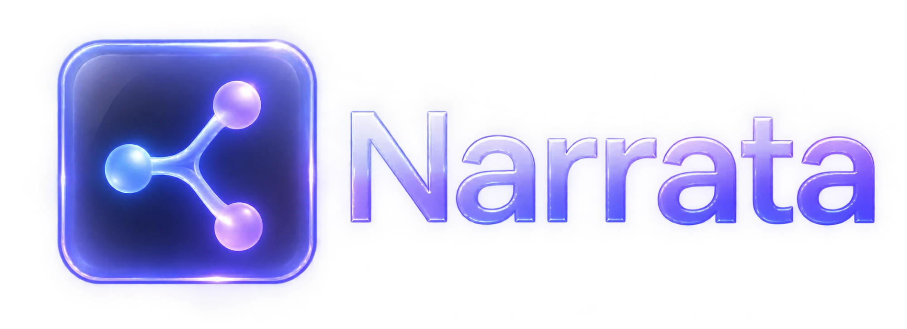
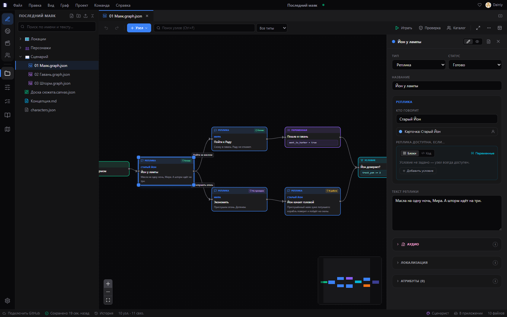
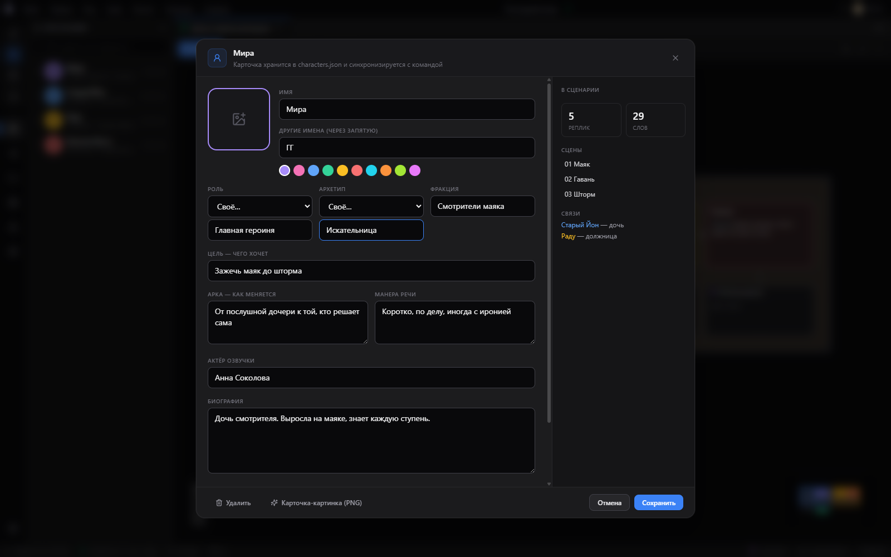
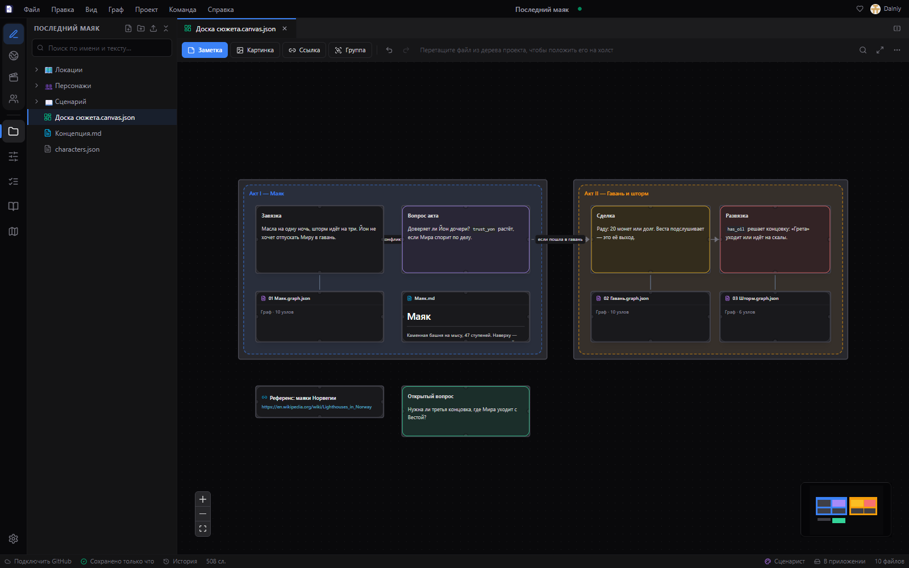

<!-- narrata:landing:start -->

  

<b>Пишите, стройте миры, проверяйте сценарии и работайте с командой — в одном приложении. Локально, без подписки и своего сервера.</b>

  
  
  
   
  
  
  

<a href="https://narrata.space/changelog.html">Что нового</a> · История изменений всех версий: <a href="CHANGELOG.md">русский</a> · <a href="CHANGELOG.en.md">English</a>

 

<table align="center">
  <tr>
    <td align="center">🔒 <b>Локальные данные</b> Вы всё контролируете</td>
    <td align="center">💎 <b>Без подписки</b> Полный доступ</td>
    <td align="center">🌐 <b>Без своего сервера</b> Работа через GitHub</td>
    <td align="center">📱 <b>Windows и Android</b> Один проект везде</td>
  </tr>
</table>

## Возможности

- 🕸️ **Графы диалогов и квестов** — Ветвления, условия и переменные — диалог проходится прямо на графе, как в игре. Играбельная версия — одним HTML-файлом.
- 👥 **База персонажей** — Карточки, связи между героями, актёры озвучки и реплики по сценам.
- 🧩 **Холст** — Заметки, документы, картинки и ссылки — на одной доске рядом с графом.
- ✅ **Проверка сценария** — Тупики, недостижимые ветки и ошибки в условиях — до того, как это увидит игрок.
- 📜 **Документы** — Markdown с вики-ссылками и режим фокуса — только текст, без панелей. Правка Word и Excel прямо в программе.
- 🌍 **Локализация и озвучка** — Таблица переводов, XLIFF и сценарий для актёров дубляжа.
- 🎮 **Экспорт в движки** — Unity, Godot, Unreal, Ren’Py, Ink, Yarn Spinner, Twine — без ручной сборки JSON.
- 🤝 **Команда через GitHub** — Синхронизация, задачи, чат, роли и закрытые папки — без своего сервера.
- 📱 **Windows и Android** — Один и тот же проект на компьютере и на планшете, с самообновлением.

## Для кого

- 🎭 **Нарративным дизайнерам** — Ветвящиеся диалоги, условия и переменные — и проверка, что игрок нигде не застрянет.
- 🎮 **Инди-разработчикам** — История и данные готовы к движку: Unity, Godot, Unreal, Ren’Py, Ink, Yarn Spinner.
- 📖 **Авторам визуальных новелл** — Портреты, реплики и выборы; готовый диалог можно пройти прямо в браузере.
- 👥 **Небольшим командам** — Общий проект через GitHub: роли, задачи, чат и проверка правок — без своего сервера.

## Установка

- **Windows 10 и 11** — скачайте `Narrata-Setup-….exe` на [странице релизов](https://github.com/DalniyX/narrata-releases/releases/latest) и запустите. Пока у установщика нет цифровой подписи, Windows может показать «Неизвестный издатель»: нажмите «Подробнее» → «Выполнить в любом случае». Дальше программа обновляется сама.
- **Android** — скачайте `.apk` оттуда же и откройте на устройстве; один раз разрешите установку из этого источника. Новые версии приложение предложит само. Удобнее всего на планшете: на телефоне всё работает, но графам и холсту на большом экране просторнее.

### Требования

| 🪟 Windows | 🤖 Android |
| --- | --- |
| Windows 10 (1809) или 11, 64-бит | Android 7.0 и новее · 📱 лучше планшет |
| 4 ГБ памяти, 400 МБ на диске | Свежий Android System WebView |
| Обновляется сама, без прав администратора | Только стабильные версии — беты выходят для Windows |

## Вопросы и ответы

<b>Это правда бесплатно?</b>

Да. Без подписок, рекламы и платных функций: все возможности доступны сразу. Поддержать разработку можно по желанию — на Boosty или разовым донатом.

<b>Где хранятся мои проекты?</b>

У вас: папкой на диске или внутри программы. Графы и документы — обычные файлы JSON и Markdown, их можно открыть и без Narrata. Ничего не уходит в интернет, пока вы сами не подключите репозиторий GitHub.

<b>Нужен ли сервер или аккаунт?</b>

Нет. Программа работает без аккаунта и без сервера. GitHub нужен, только если хотите синхронизацию между устройствами или командную работу — хватит бесплатного репозитория.

<b>Чем отличается от Twine, Ink или articy:draft?</b>

Narrata — рабочая среда целиком: граф, персонажи, документы и холст в одном проекте, с проверкой сценария и командной работой. Ink и Yarn Spinner — языки сценариев, и Narrata в них экспортирует; из Twine и Ink можно импортировать. От articy:draft отличается тем, что бесплатна и хранит проект обычными файлами.

<b>Windows пишет «Неизвестный издатель». Это нормально?</b>

Да. У установщика пока нет платной цифровой подписи. Нажмите «Подробнее» → «Выполнить в любом случае». Файлы выкладываются только на странице релизов GitHub — скачивайте оттуда.

<b>Работает ли на телефоне?</b>

Да, есть версия для Android с теми же проектами и самообновлением. Удобнее всего на планшете: графу и холсту нужен простор.

## Сообщество и поддержка

[Сайт](https://narrata.space/) · [Telegram](https://t.me/DalniyX) · [Boosty](https://boosty.to/narrata/donate) · [DonationAlerts](https://dalink.to/dalniyx)

## Обратная связь

Нашли ошибку или хотите что-то предложить — в программе «Справка → Обратная связь» или [обращением на GitHub](https://github.com/DalniyX/narrata-releases/issues).

## Перевод

Интерфейс переводит сообщество. Нет вашего языка или хотите его улучшить — переводы принимаются через pull request, инструкция и шаблон в папке [`locales/`](https://github.com/DalniyX/narrata-releases/tree/main/locales).

## Лицензия

Narrata — программа с закрытым исходным кодом; здесь публикуются только установщики. Установка означает согласие с [лицензионным соглашением](LICENSE.md): копировать, распространять установщики на других площадках и декомпилировать программу без разрешения правообладателя нельзя.

<!-- narrata:landing:end -->

<!-- narrata:supporters:start -->
## ❤️ Благодарности

Спасибо всем, кто поддерживает Narrata!

_Список пока пуст — станьте первым._
<!-- narrata:supporters:end -->
